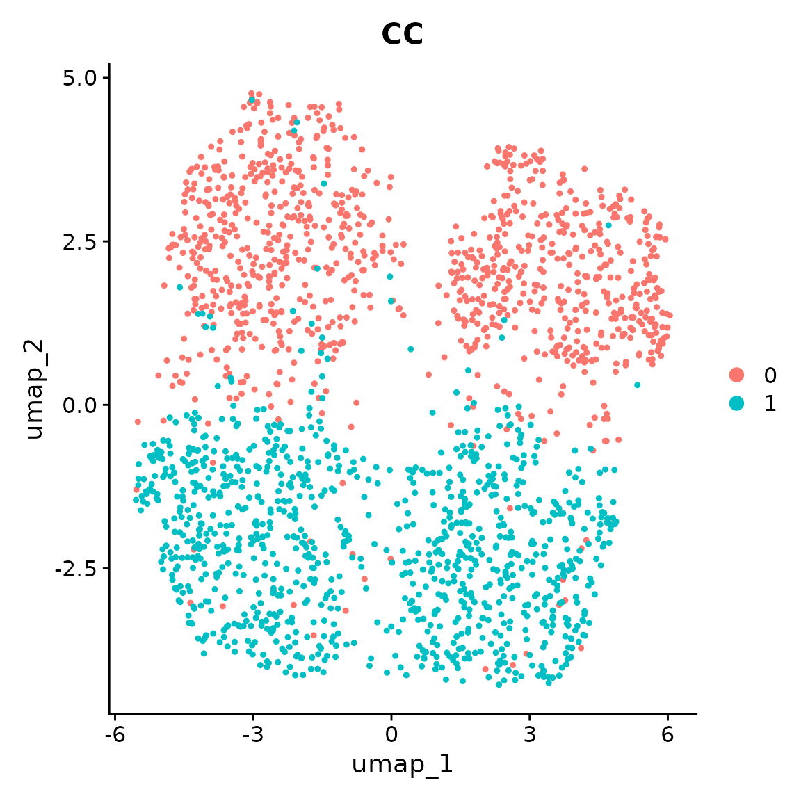
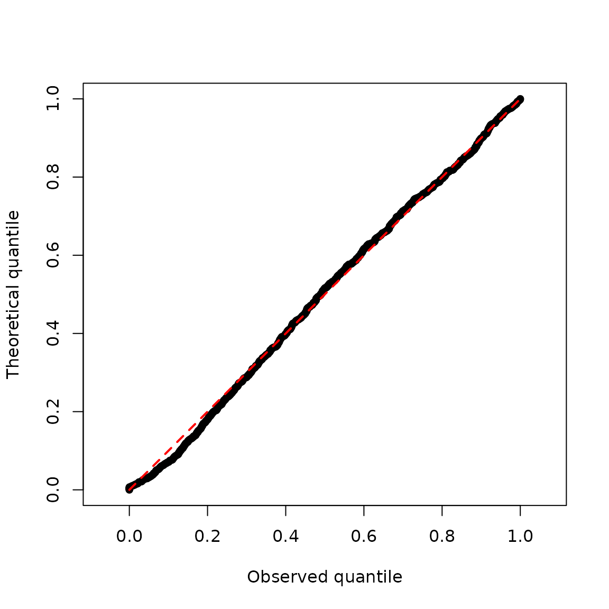
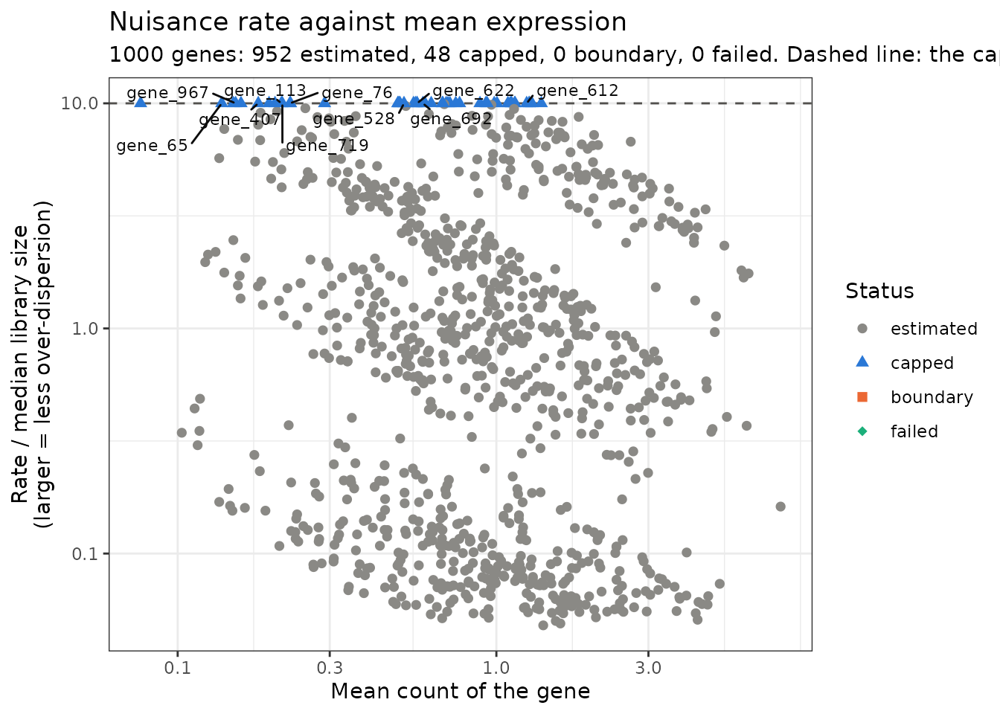
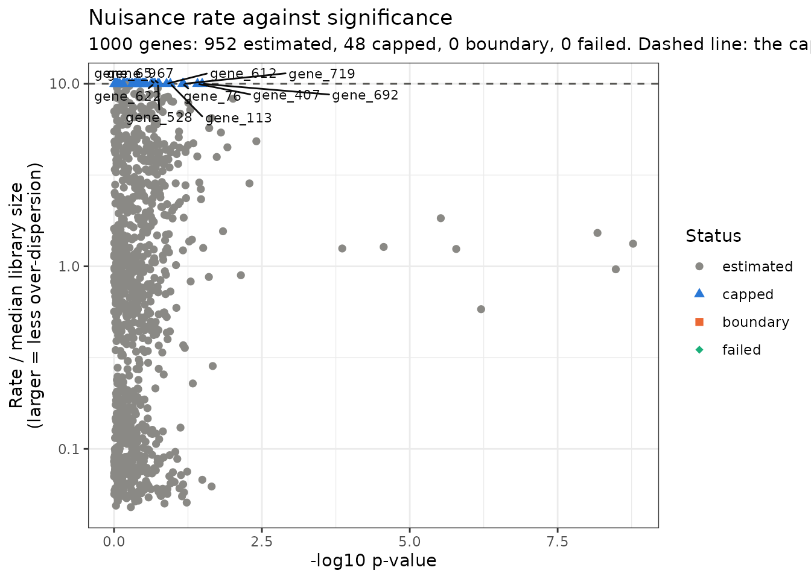
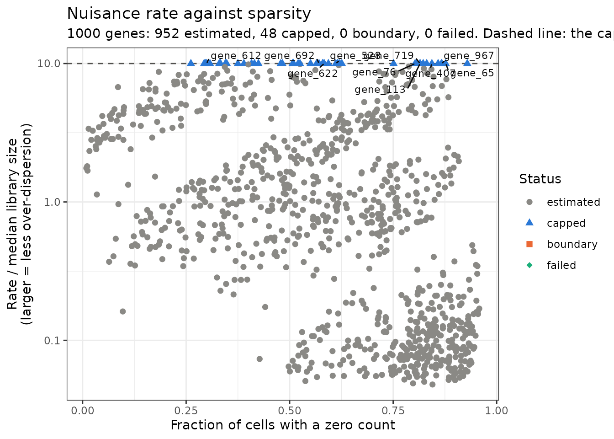
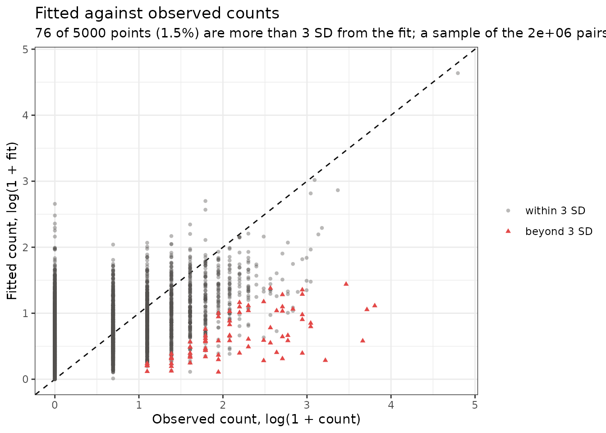
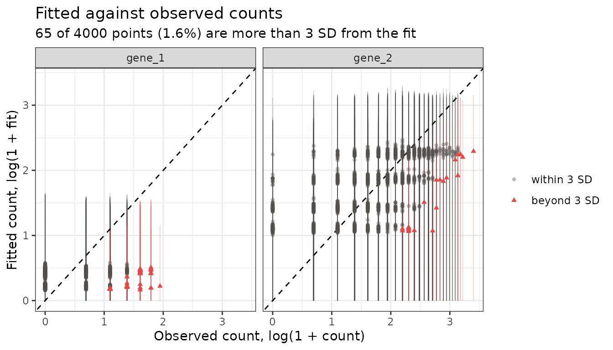

# eSVD-DE Overview

## Purpose

The simulations here are meant to be portable, toy-examples of eSVD2,
with the intent to demonstrate that an installation of eSVD2 was
successful.

This vignette was rendered with `eSVD2` version 1.2.0. A successful
installation of `eSVD2` is required for this. See the last section of
this vignette for the session information used when it was rendered. The
whole vignette should complete in less than 2 minutes.

## Overview

Broadly speaking, eSVD-DE (the name of the method, which is implemented
in the `eSVD2` package) is a pipeline of 6 different function calls. The
procedure starts with primarily 3 inputs,

- `dat`, either `matrix` or `dgCMatrix`, with `n` rows (for `n` cells)
  and `p` columns (for `p` genes). We advise making sure each row/column
  of either matrix has non-zero variance prior to using this pipeline.
- `covariates`, a `matrix` with `n` rows with the same rownames as `dat`
  where the columns represent the different covariates Notably, this
  should contain only numerical columns (i.e., all categorical variables
  should have already been split into numerous indicator variables), and
  all the columns in `covariates` will (strictly speaking) be included
  in the eSVD matrix factorization model.
- `metadata_individual`, a `factor` vector with length `n` which denotes
  which cell originates from which individual.

``` r

library(eSVD2)
# Seurat is only used for the UMAP below; every eSVD2 step runs without it.
has_seurat <- requireNamespace("Seurat", quietly = TRUE)
# ggplot2 and ggrepel are only used for the diagnostic plots at the end.
has_ggplot <- requireNamespace("ggplot2", quietly = TRUE) &&
  requireNamespace("ggrepel", quietly = TRUE)
```

## Simulating data

We create a simple dataset that has no differentially expressed genes
via the
[`eSVD2::generate_null()`](https://linnykos.github.io/eSVD2/reference/generate_null.md)
function.

``` r

set.seed(10)
res <- eSVD2::generate_null()
covariates <- res$covariates
metadata_individual <- res$metadata_individual
obs_mat <- res$obs_mat
```

If you have Seurat also installed, you can run the following lines as
well (the chunk is skipped otherwise),

``` r

set.seed(10)
meta_data <- data.frame(covariates[, c("CC", "Sex", "Age")])
meta_data$Individual <- metadata_individual
seurat_obj <- Seurat::CreateSeuratObject(counts = Matrix::t(obs_mat), meta.data = meta_data)
Seurat::VariableFeatures(seurat_obj) <- rownames(seurat_obj)
seurat_obj <- Seurat::NormalizeData(seurat_obj)
seurat_obj <- Seurat::ScaleData(seurat_obj)
seurat_obj <- Seurat::RunPCA(seurat_obj, verbose = FALSE)
seurat_obj <- Seurat::RunUMAP(seurat_obj, dims = 1:5)

Seurat::DimPlot(seurat_obj, reduction = "umap", group.by = "CC")
```



The separation between case and control cells is purely determined by
the individual covariates of Age and Sex, not the case-control status.

## Using eSVD-DE

- **Step 1 (Initializing the eSVD object):** First, we initialize the
  object of class `eSVD`, which we will call `eSVD_obj`. This is done
  using the
  [`eSVD2::initialize_esvd()`](https://linnykos.github.io/eSVD2/reference/initialize_esvd.md)
  function. All the following operations will use `eSVD_obj` for all
  calculations through the usage of this method. This is where we pass
  the inputs `dat`, `covariates`, and `metadata_individual`. Notice that
  after
  [`eSVD2::initialize_esvd()`](https://linnykos.github.io/eSVD2/reference/initialize_esvd.md)
  (and later, after
  [`eSVD2::opt_esvd()`](https://linnykos.github.io/eSVD2/reference/opt_esvd.md))
  we always call
  [`eSVD2::reparameterization_esvd_covariates()`](https://linnykos.github.io/eSVD2/reference/reparameterization_esvd_covariates.md)
  to ensure that the fit remains identifiable.

Empirically, we have found it useful to set `omitted_variables` as the
`Log_UMI` and the batch variables. (Here, there are no batch variables.)
This means that when eSVD2 reparameterizes the variables, it does not
fiddle with the coefficient for `Log_UMI`. We found this beneficial
since the coefficient for specifically the covariate `Log_UMI` bears a
special meaning (as it impacts the normalization of the sequencing depth
most directly), and we do not wish to “mix” covariates correlated with
`Log_UMI` too early. (Overall, this is not a strict recommendation,
however, we have found this practice to be beneficial in almost all
instances we have used eSVD2, so we ourselves have not tried deviating
from this convention.)

This typically looks like the following.

``` r

set.seed(10)
eSVD_obj <- eSVD2::initialize_esvd(
  dat = obs_mat,
  covariates = covariates,
  metadata_individual = metadata_individual,
  case_control_variable = "CC",
  bool_intercept = TRUE,
  k = 5,
  lambda = 0.1,
  verbose = 0
)
eSVD_obj <- eSVD2::reparameterization_esvd_covariates(
  input_obj = eSVD_obj,
  fit_name = "fit_Init",
  omitted_variables = "Log_UMI"
)

names(eSVD_obj)
#> [1] "dat"          "covariates"   "param"        "fit_Init"     "latest_Fit"  
#> [6] "case_control" "individual"
```

- **Step 2 (Fitting the eSVD object):** We now fit the eSVD. Typically,
  we recommend fitting twice (i.e., calling
  [`eSVD2::opt_esvd()`](https://linnykos.github.io/eSVD2/reference/opt_esvd.md)
  twice) due to the non-convex nature of the objective function. In the
  first call of
  [`eSVD2::opt_esvd()`](https://linnykos.github.io/eSVD2/reference/opt_esvd.md),
  hold all the coefficients to all the covariates aside from the
  case-control covariate (here, denoted as `"CC"` so we remove as much
  of the case-control covariate effect as possible. Then, in the second
  call of
  [`eSVD2::opt_esvd()`](https://linnykos.github.io/eSVD2/reference/opt_esvd.md),
  we allow all the coefficients to be optimized.

Note that in the last fit of
[`eSVD2::opt_esvd()`](https://linnykos.github.io/eSVD2/reference/opt_esvd.md),
we do not set any `omitted_variables`. This is our typical
recommendation – it is good to allow all coefficients to be
reparameterized right before the optimization is all done.

``` r

set.seed(10)
eSVD_obj <- eSVD2::opt_esvd(
  input_obj = eSVD_obj,
  l2pen = 0.1,
  max_iter = 100,
  offset_variables = setdiff(colnames(eSVD_obj$covariates), "CC"),
  tol = 1e-6,
  verbose = 0,
  fit_name = "fit_First",
  fit_previous = "fit_Init"
)
eSVD_obj <- eSVD2::reparameterization_esvd_covariates(
  input_obj = eSVD_obj,
  fit_name = "fit_First",
  omitted_variables = "Log_UMI"
)

set.seed(10)
eSVD_obj <- eSVD2::opt_esvd(
  input_obj = eSVD_obj,
  l2pen = 0.1,
  max_iter = 100,
  offset_variables = NULL,
  tol = 1e-6,
  verbose = 0,
  fit_name = "fit_Second",
  fit_previous = "fit_First"
)

eSVD_obj <- eSVD2::reparameterization_esvd_covariates(
  input_obj = eSVD_obj,
  fit_name = "fit_Second",
  omitted_variables = NULL
)

names(eSVD_obj)
#> [1] "dat"          "covariates"   "param"        "fit_Init"     "latest_Fit"  
#> [6] "case_control" "individual"   "fit_First"    "fit_Second"
```

- **Step 3 (Estimating the nuisance (i.e., over-dispersion)
  parameters):** After fitting the eSVD, we need to estimate the
  nuisance parameters. Since we are modeling the data via a negative
  binomial, this nuisance parameter is the over-dispersion parameter.
  This is done via the
  [`eSVD2::estimate_nuisance()`](https://linnykos.github.io/eSVD2/reference/estimate_nuisance.md)
  function.

``` r

set.seed(10)
eSVD_obj <- eSVD2::estimate_nuisance(
  input_obj = eSVD_obj,
  bool_covariates_as_library = TRUE,
  bool_library_includes_interept = TRUE,
  bool_use_log = FALSE,
  cap_multiplier = 10,
  min_val = 1e-4,
  verbose = 0
)

names(eSVD_obj)
#> [1] "dat"          "covariates"   "param"        "fit_Init"     "latest_Fit"  
#> [6] "case_control" "individual"   "fit_First"    "fit_Second"
```

The value stored in `eSVD_obj$fit_Second$nuisance_vec` is the Gamma
*rate*, the reciprocal of the over-dispersion, so a larger value means
less over-dispersion. **No gene’s rate is allowed above `cap_multiplier`
times the median of its library size.** A gene whose counts are no more
variable around the fit than a Poisson has no finite maximum-likelihood
rate, and without the cap its test statistic is inflated. The function
records what it did with each gene, and how many genes the cap acted on.

``` r

table(eSVD_obj$fit_Second$nuisance_status)
#> 
#> estimated    capped  boundary    failed 
#>       952        48         0         0
eSVD_obj$param$nuisance_num_capped
#> [1] 48
```

- **Step 4 (Computing the posterior):** With the over-disperison
  parameter estimated, we are now ready to compute the posterior mean
  and variance of each cell’s gene expression value. This posterior
  distribution is to balance out the fitted eSVD denoised value against
  the covariate-adjusted library size. This step ensures that even
  though we pooled all the genes to denoise the single-cell expression
  matrix, we do not later inflate the Type-1 error. This is done via the
  [`eSVD2::compute_posterior()`](https://linnykos.github.io/eSVD2/reference/compute_posterior.md)
  function.

``` r

set.seed(10)
eSVD_obj <- eSVD2::compute_posterior(
  input_obj = eSVD_obj,
  bool_adjust_covariates = FALSE,
  alpha_max = 100,
  bool_covariates_as_library = TRUE,
  bool_stabilize_underdispersion = TRUE,
  library_min = 1,
  pseudocount = 0
)

names(eSVD_obj)
#> [1] "dat"          "covariates"   "param"        "fit_Init"     "latest_Fit"  
#> [6] "case_control" "individual"   "fit_First"    "fit_Second"
```

- **Step 5 (Computing the test statistics):** Now we can compute the
  test statistics using the
  [`eSVD2::compute_test_statistic()`](https://linnykos.github.io/eSVD2/reference/compute_test_statistic.md)
  function.

``` r

set.seed(10)
eSVD_obj <- eSVD2::compute_test_statistic(input_obj = eSVD_obj, verbose = 0)

names(eSVD_obj)
#>  [1] "dat"           "covariates"    "param"         "fit_Init"     
#>  [5] "latest_Fit"    "case_control"  "individual"    "fit_First"    
#>  [9] "fit_Second"    "teststat_vec"  "case_mean"     "control_mean" 
#> [13] "case_var"      "control_var"   "log2fc_vec"    "log2fc_se_vec"
```

- **Step 6 (Computing the p-values):** Lastly, we can compute the
  p-values via the
  [`eSVD2::compute_pvalue()`](https://linnykos.github.io/eSVD2/reference/compute_pvalue.md)
  function.

``` r

set.seed(10)
eSVD_obj <- eSVD2::compute_pvalue(input_obj = eSVD_obj)

names(eSVD_obj)
#>  [1] "dat"           "covariates"    "param"         "fit_Init"     
#>  [5] "latest_Fit"    "case_control"  "individual"    "fit_First"    
#>  [9] "fit_Second"    "teststat_vec"  "case_mean"     "control_mean" 
#> [13] "case_var"      "control_var"   "log2fc_vec"    "log2fc_se_vec"
#> [17] "pvalue_list"
```

To visualize the p-values, we can plot the theoretical quantiles against
the observed quantiles. We see that despite the UMAP above showing
strong differences between the case and control cells, the p-values are
all uniformly distributed. This shows that we do not inflate the Type-1
error.

``` r

pvalue_vec <- 10 ^ (-eSVD_obj$pvalue_list$log10pvalue)
graphics::plot(
  x = sort(pvalue_vec),
  y = seq(0, 1, length.out = length(pvalue_vec)),
  asp = TRUE,
  pch = 16,
  xlab = "Observed quantile",
  ylab = "Theoretical quantile"
)
graphics::lines(
  x = c(0, 1),
  y = c(0, 1),
  col = "red",
  lty = 2,
  lwd = 2
)
```



- **Step 7 (Reporting the results):** The function
  [`eSVD2::report_results()`](https://linnykos.github.io/eSVD2/reference/report_results.md)
  collects the results into a data frame with one row per gene. The
  column `logFC` is the log2 fold change between the case and the
  control individuals, and `logFC_se` is its standard error, also on the
  log2 scale. Both are computed during Step 5 and are stored in
  `eSVD_obj$log2fc_vec` and `eSVD_obj$log2fc_se_vec`.

``` r

result_df <- eSVD2::report_results(eSVD_obj)
utils::head(result_df[order(result_df$log10pvalue, decreasing = TRUE), ])
#>           genes     logFC  logFC_se log10pvalue       pvalue   pvalue_adj
#> gene_4   gene_4 -1.424179 0.2391974    8.775406 1.677234e-09 1.643850e-06
#> gene_2   gene_2  1.402981 0.2388398    8.483108 3.287700e-09 1.643850e-06
#> gene_7   gene_7 -1.496344 0.2701915    8.173464 6.707123e-09 2.235708e-06
#> gene_8   gene_8  1.231841 0.2777484    6.206151 6.220846e-07 1.555211e-04
#> gene_6   gene_6 -1.529188 0.3718676    5.785213 1.639786e-06 3.279573e-04
#> gene_10 gene_10  1.444870 0.3517191    5.524298 2.990211e-06 4.983685e-04
#>         nuisance_status
#> gene_4        estimated
#> gene_2        estimated
#> gene_7        estimated
#> gene_8        estimated
#> gene_6        estimated
#> gene_10       estimated
```

The standard error is divided by the number of individuals in each arm
and not by the number of cells, so it is on the same footing as the
standard error from a pseudobulk analysis. Multiply `logFC` and
`logFC_se` by `log(2)` to move both to the natural-log scale. Note that
`logFC / logFC_se` is not the statistic behind the p-value, which is
computed on the linear scale and calibrated with an empirical null. See
[`?eSVD2::compute_log_fold_change`](https://linnykos.github.io/eSVD2/reference/compute_log_fold_change.md)
for what the standard error does and does not account for.

## Diagnostics of the over-dispersion

The over-dispersion decides how much each cell’s posterior follows the
fit, so it is worth a look before the results are used. The two
functions below draw what Step 3 estimated. They need the packages
`ggplot2` and `ggrepel`.

**The rate of each gene, against three summaries of the gene.**
[`eSVD2::plot_nuisance()`](https://linnykos.github.io/eSVD2/reference/plot_nuisance.md)
draws the rate divided by the gene’s median library size, which puts
every gene in the same units. The dashed line is the cap, and the genes
it acted on sit on it. Most genes should be below the line. Where genes
are at the line, they should be the lowly expressed and sparse ones, and
they should not make up the most significant genes.

``` r

plot1 <- eSVD2::plot_nuisance(input_obj = eSVD_obj,
                              x_axis = "mean_expression")
plot(plot1)
```



``` r

plot1 <- eSVD2::plot_nuisance(input_obj = eSVD_obj,
                              x_axis = "log10pvalue")
plot(plot1)
```



``` r

plot1 <- eSVD2::plot_nuisance(input_obj = eSVD_obj,
                              x_axis = "sparsity")
plot(plot1)
```



**The fitted count against the observed count.** In
[`eSVD2::plot_fitted_vs_observed()`](https://linnykos.github.io/eSVD2/reference/plot_fitted_vs_observed.md)
each point is one cell and one gene, and a point is red when its count
is more than 3 standard deviations from its fit, the standard deviation
being the one the model implies for that gene’s over-dispersion. The
points should follow the dashed line, and only a small share should be
red. With `bool_draw_bars = TRUE` each point carries the interval of 3
standard deviations around its fit: bars that are too short to reach the
line mean the over-dispersion is underestimated, and bars that reach far
past it for nearly every point mean it is overestimated.

``` r

plot1 <- eSVD2::plot_fitted_vs_observed(input_obj = eSVD_obj,
                                        max_points = 5000)
plot(plot1)
```



The argument `genes` draws every cell of the genes named, one panel per
gene.

``` r

plot1 <- eSVD2::plot_fitted_vs_observed(input_obj = eSVD_obj,
                                        genes = colnames(obs_mat)[1:2],
                                        bool_draw_bars = TRUE)
plot(plot1)
```



**Redoing the test at another cap.** The factorization does not depend
on the cap, so the test can be redone at another `cap_multiplier`
without fitting again. `cap_multiplier = 1` is close to the behavior of
the version of `eSVD2` that accompanied the paper, and `Inf` removes the
cap.

``` r

eSVD_obj_cap1 <- eSVD2::recompute_pvalue(input_obj = eSVD_obj,
                                         cap_multiplier = 1)
eSVD_obj_cap1$param$nuisance_num_capped
#> [1] 461
stats::cor(eSVD_obj$teststat_vec, eSVD_obj_cap1$teststat_vec)
#> [1] 0.9739539
```

> **When the object has no counts.**
> [`eSVD2::eSVD()`](https://linnykos.github.io/eSVD2/reference/eSVD.md)
> and
> [`eSVD2::eSVD_helper()`](https://linnykos.github.io/eSVD2/reference/eSVD_helper.md)
> return an object without the count matrix by default
> (`bool_diet = TRUE`). For such an object, pass the Seurat object the
> analysis was run on as `seurat_obj` to
> [`eSVD2::recompute_pvalue()`](https://linnykos.github.io/eSVD2/reference/recompute_pvalue.md)
> and to
> [`eSVD2::plot_fitted_vs_observed()`](https://linnykos.github.io/eSVD2/reference/plot_fitted_vs_observed.md).
> [`eSVD2::plot_nuisance()`](https://linnykos.github.io/eSVD2/reference/plot_nuisance.md)
> needs no counts.

## Setup

The session information when this vignette was rendered.

``` r

sessionInfo()
#> R version 4.6.1 (2026-06-24)
#> Platform: x86_64-pc-linux-gnu
#> Running under: Ubuntu 24.04.5 LTS
#> 
#> Matrix products: default
#> BLAS:   /usr/lib/x86_64-linux-gnu/openblas-pthread/libblas.so.3 
#> LAPACK: /usr/lib/x86_64-linux-gnu/openblas-pthread/libopenblasp-r0.3.26.so;  LAPACK version 3.12.0
#> 
#> locale:
#>  [1] LC_CTYPE=C.UTF-8       LC_NUMERIC=C           LC_TIME=C.UTF-8       
#>  [4] LC_COLLATE=C.UTF-8     LC_MONETARY=C.UTF-8    LC_MESSAGES=C.UTF-8   
#>  [7] LC_PAPER=C.UTF-8       LC_NAME=C              LC_ADDRESS=C          
#> [10] LC_TELEPHONE=C         LC_MEASUREMENT=C.UTF-8 LC_IDENTIFICATION=C   
#> 
#> time zone: UTC
#> tzcode source: system (glibc)
#> 
#> attached base packages:
#> [1] stats     graphics  grDevices utils     datasets  methods   base     
#> 
#> other attached packages:
#> [1] eSVD2_1.2.0
#> 
#> loaded via a namespace (and not attached):
#>   [1] deldir_2.0-4           pbapply_1.7-5          gridExtra_2.3.1       
#>   [4] rlang_1.3.0            magrittr_2.0.5         RcppAnnoy_0.0.23      
#>   [7] otel_0.2.0             spatstat.geom_3.8-3    matrixStats_1.5.0     
#>  [10] ggridges_0.5.7         compiler_4.6.1         png_0.1-9             
#>  [13] systemfonts_1.3.2      vctrs_0.7.3            reshape2_1.4.5        
#>  [16] stringr_1.6.0          shape_1.4.6.1          pkgconfig_2.0.3       
#>  [19] fastmap_1.2.0          labeling_0.4.3         promises_1.5.0        
#>  [22] rmarkdown_2.32         ragg_1.5.2             purrr_1.2.2           
#>  [25] glmnet_5.1             xfun_0.61              cachem_1.1.0          
#>  [28] jsonlite_2.0.0         goftest_1.2-3          later_1.4.8           
#>  [31] spatstat.utils_3.2-5   irlba_2.4.1            parallel_4.6.1        
#>  [34] cluster_2.1.8.2        R6_2.6.1               ica_1.0-3             
#>  [37] spatstat.data_3.1-9    bslib_0.12.0           stringi_1.8.9         
#>  [40] RColorBrewer_1.1-3     reticulate_1.47.0      spatstat.univar_3.2-0 
#>  [43] parallelly_1.48.0      lmtest_0.9-40          jquerylib_0.1.4       
#>  [46] scattermore_1.2        iterators_1.0.14       Rcpp_1.1.2            
#>  [49] knitr_1.52             tensor_1.5.1           future.apply_1.20.2   
#>  [52] zoo_1.9-1              sctransform_0.4.3      httpuv_1.6.17         
#>  [55] Matrix_1.7-5           splines_4.6.1          igraph_2.3.4          
#>  [58] tidyselect_1.2.1       abind_1.4-8            yaml_2.3.12           
#>  [61] spatstat.random_3.5-2  spatstat.explore_3.8-3 codetools_0.2-20      
#>  [64] miniUI_0.1.2           listenv_1.1.0          lattice_0.22-9        
#>  [67] tibble_3.3.1           plyr_1.8.9             withr_3.0.3           
#>  [70] shiny_1.14.0           S7_0.2.2               ROCR_1.0-12           
#>  [73] evaluate_1.0.5         Rtsne_0.17             future_1.76.0         
#>  [76] fastDummies_1.7.6      desc_1.4.3             survival_3.8-6        
#>  [79] polyclip_1.10-7        fitdistrplus_1.2-6     pillar_1.11.1         
#>  [82] Seurat_5.6.0           KernSmooth_2.23-26     foreach_1.5.2         
#>  [85] plotly_4.12.1          generics_0.1.4         RcppHNSW_0.7.0        
#>  [88] sp_2.2-3               ggplot2_4.0.3          scales_1.4.0          
#>  [91] globals_0.19.1         xtable_1.8-8           glue_1.8.1            
#>  [94] tools_4.6.1            data.table_1.18.6.1    RSpectra_0.16-2       
#>  [97] RANN_2.6.3             fs_2.1.0               dotCall64_1.2         
#> [100] cowplot_1.2.0          grid_4.6.1             tidyr_1.3.2           
#> [103] nlme_3.1-169           patchwork_1.3.2        cli_3.6.6             
#> [106] spatstat.sparse_3.2-0  textshaping_1.0.5      spam_2.11-4           
#> [109] viridisLite_0.4.3      dplyr_1.2.1            uwot_0.2.5            
#> [112] gtable_0.3.6           sass_0.4.10            digest_0.6.39         
#> [115] progressr_1.0.0        ggrepel_0.9.8          htmlwidgets_1.6.4     
#> [118] SeuratObject_5.4.0     farver_2.1.2           htmltools_0.5.9       
#> [121] pkgdown_2.2.1          lifecycle_1.0.5        httr_1.4.9            
#> [124] locfdr_1.1-8           mime_0.13              MASS_7.3-65
```
