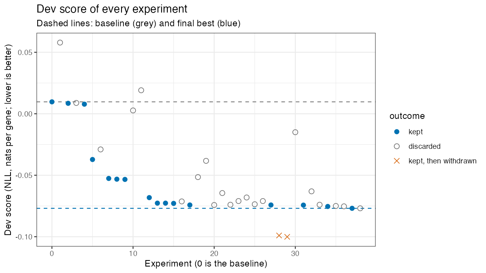
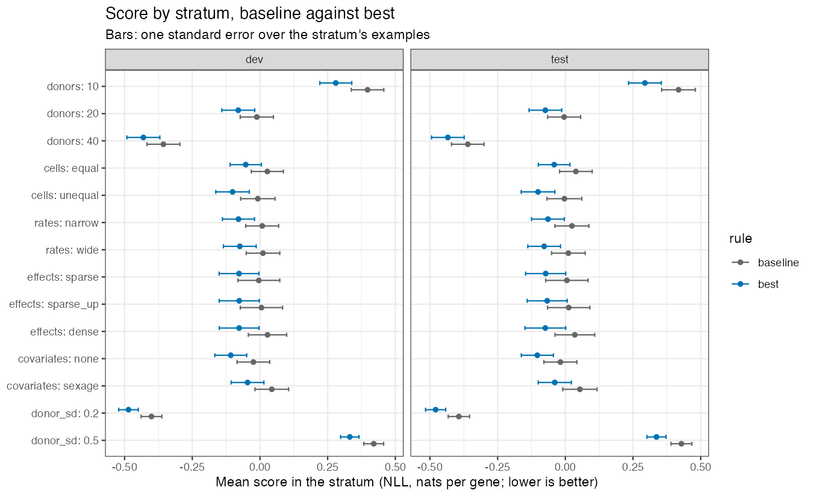
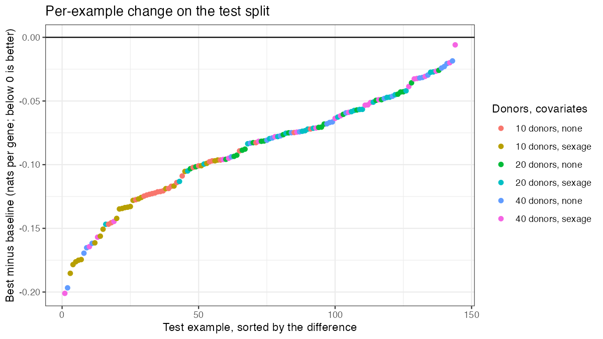
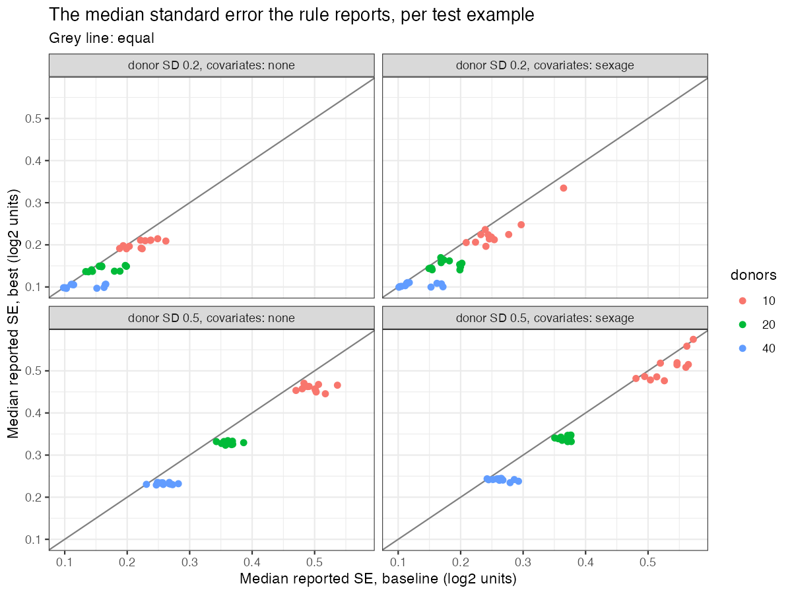

# Run `nov11`: a reporting rule for the log fold change and its standard error

Kevin Z. Lin (drafted by Claude), 2026-11-11. The design is
`MEMO_claude.md`, the bank is `BANK.md`, and the kept rule is
`RULE_nov11_claude.R`.

## 1. The run

| | |
|---|---|
| Branch | `autoresearch_lfcse/nov11`, cut from `2026-11-07_std` at `89ff8f8` |
| Budget agreed at setup | 40 experiments or 4 hours, 8 cores for a scoring |
| What stopped it | A decision at 38 experiments: the last eight valid experiments moved the dev score by 0.003 in total, and the two ideas left were weaker than the ones just discarded |
| Experiments by status | 38 after the baseline: 17 `keep` (2 of them later withdrawn, section 6), 21 `discard`, no `gate_failed`, `crash` or `timeout` row (two crashes were coding errors, fixed and amended before logging) |
| Wall-clock per scoring | 16 to 19 seconds on 8 cores |
| Best commit | `5df592c` |

**One departure from the protocol.** Experiments 28 and 29 (`da743dc`,
`b3fc556`) passed the keep rule with a gain of 0.025 nats and were then
withdrawn, because their standard error followed the estimated logFC
(section 6). The branch was reset to the previous kept commit `1de04e6`, the
best-score files were rebuilt from a fresh scoring of it, and the two
commits are preserved on the branch `autoresearch_lfcse/nov11-gap-invalid`.
Their rows remain in `results.tsv` with status `keep`, and the rollback is
recorded in the description of the next row (`bf6e2d4`).

## 2. The best commit

Commit `5df592c`: "moderation trend against the mean fitted log ratio over
donors instead of the two arms' log arithmetic means."

The rule now reports the case-control coefficient of a donor-level weighted
regression. Each donor is summarized, gene by gene, by the logarithm of its
summed counts over its summed fitted library sizes, and these log donor
means are regressed on the arm and on every covariate that is constant
within donors. Donors are weighted by a precision that falls as the donor's
expected count for the gene falls, the residual variance is moderated across
genes in the manner of limma, and the logFC is shifted by one constant per
cohort taken from the empirical null of the Wald statistics. The rule reads
the counts, the design and the fitted library; it no longer reads the
posterior mean, the posterior variance or the nuisance rate.

## 3. The procedure

**Input and output.** The function `report_lfc_se(view)` receives the counts
$A_{cg}$ of cell $c$ and gene $g$, the fitted library size $\ell_{cg}$ (every
fitted covariate effect except the case-control one, the gene intercept
included), the donor $d(c)$ and arm of each cell, and the design matrix of
the fit. It returns $(\widehat\beta_g, s_g)$ for every gene, in log2 units.

**Baseline (`raw_null`).** With $m_{dg}$ the mean of $A_{cg} / \ell_{cg}$
over the cells of donor $d$, $M_{1g}, M_{0g}$ the arm means over $n_1, n_0$
donors and $V_{1g}, V_{0g}$ the sample variances of the donor means,

$$\widehat\beta^{\,\text{raw}}_g = \log_2\frac{M_{1g}}{M_{0g}}, \qquad
s^{\text{raw}}_g = \frac{1}{\ln 2}\sqrt{\frac{V_{1g}}{n_1 M_{1g}^2} + \frac{V_{0g}}{n_0 M_{0g}^2}},$$

and with $(\delta_0, \sigma_0)$ the mean and SD of the empirical null fitted
to $\widehat\beta^{\,\text{raw}}_g / s^{\text{raw}}_g$, the baseline reports
$(\widehat\beta^{\,\text{raw}}_g - \delta_0 s^{\text{raw}}_g,\; \sigma_0 s^{\text{raw}}_g)$.

**The kept rule.**

1. *Donor summary.* With $y_{dg} = \sum_{c \in d} A_{cg}$ and
   $L_{dg} = \sum_{c \in d} \ell_{cg}$,
   $$l_{dg} = \log\frac{y_{dg} + 1/2}{L_{dg}}.$$
   The half count is the continuity correction of a Poisson count, which
   keeps the logarithm finite for a donor with no count.
2. *Design.* $D$ is the $n \times p$ donor-level matrix whose columns are the
   intercept, the arm indicator, and every column of the fit's design that is
   constant within donors, reduced to full rank.
3. *Donor offsets.* With $r_{dg}$ the residuals of the least-squares
   regression of $l_{\cdot g}$ on $D$, each donor's offset is
   $o_d = \text{median}_g\, r_{dg}$, and $l_{dg} \leftarrow l_{dg} - o_d$. The
   regression is repeated, giving fitted values $f_{dg}$ and residuals
   $r_{dg}$.
4. *Precision weights.* With $\mu_{dg} = L_{dg}\, e^{f_{dg}}$ the expected
   count, the two constants of
   $$\text{Var}(l_{dg}) = \tau^2 + \frac{\phi}{\mu_{dg}}$$
   are fitted by least squares of $r_{dg}^2\, n / (n - p)$ on $1 / \mu_{dg}$
   over all donors and genes, each floored at 0, and
   $w_{dg} = 1 / (\tau^2 + \phi / \mu_{dg})$.
5. *Weighted regression.* With $W_g = \text{diag}(w_{\cdot g})$,
   $$\widehat\theta_g = (D^\top W_g D)^{-1} D^\top W_g\, l_{\cdot g}, \qquad
   a_g = \big[(D^\top W_g D)^{-1}\big]_{\text{arm}}, \qquad
   S_g = \frac{1}{n - p}\sum_d w_{dg}\,(l_{dg} - D_d^\top \widehat\theta_g)^2 .$$
6. *Moderated variance* (Smyth 2004). A smoothing spline $t(\cdot)$, its
   smoothness chosen by generalized cross-validation, is fitted to
   $\log S_g$ against $x_g = \tfrac1n \sum_d f_{dg}$, the gene's mean fitted
   log ratio. With $\nu = n - p$, $\psi$ the digamma function and $\psi'$ the
   trigamma function, the prior degrees of freedom $\nu_0$ solve
   $\psi'(\nu_0 / 2) = \text{mean}_g\,(\log S_g - t(x_g))^2 - \psi'(\nu / 2)$,
   the prior variance is
   $\log S_{0g} = t(x_g) - \psi(\nu/2) + \log(\nu/2) + \psi(\nu_0/2) - \log(\nu_0/2)$,
   and
   $$\widetilde S_g = \frac{\nu_0 S_{0g} + \nu S_g}{\nu_0 + \nu}.$$
   When the right-hand side of the equation for $\nu_0$ is not positive,
   $\nu_0 = \infty$ and $\widetilde S_g = \exp\{t(x_g) - \psi(\nu/2) + \log(\nu/2)\}$.
7. *The pair before centring.*
   $$\widehat\beta^{\,0}_g = \frac{\widehat\theta_{g,\text{arm}}}{\ln 2}, \qquad
   s_g = \frac{\sqrt{\widetilde S_g\, a_g}}{\ln 2}.$$
8. *Centring.* With $\delta_0$ the mean of the empirical null fitted by
   `eSVD2::multtest()` (locfdr's maximum-likelihood fit) to
   $z_g = \widehat\beta^{\,0}_g / s_g$,
   $$\widehat\beta_g = \widehat\beta^{\,0}_g - \delta_0 \cdot \text{median}_g\, s_g .$$
   The rule reports $(\widehat\beta_g, s_g)$. The null's SD is not used.

What changed against the baseline: the donor summary (ratio of sums, on the
log scale), the estimator (a regression that re-adjusts for donor-level
covariates and weights donors by precision), the variance (pooled over the
arms, moderated across genes, with the covariates' cost in $a_g$ and in
$\nu$), and the centring (a constant in place of a shift proportional to
each gene's SE; no rescaling by the null's SD).

The implementation is `notes/RULE_nov11_claude.R`, which mirrors `5df592c`
and was sourced alone in an empty folder, where it returned the trial file's
value exactly on `dev_050`.

## 4. Dev and test blocks beside the baseline's

```
                            baseline              best (5df592c)
                            dev        test       dev        test
score:                      0.0097     0.0178     -0.0769    -0.0712
score_se:                   0.0433     0.0440     0.0422     0.0426
rmse:                       0.2937     0.2972     0.2855     0.2883
coverage_95:                0.9484     0.9484     0.9518     0.9502
z_sd_null:                  1.0269     1.0295     0.9961     1.0011
bias_null:                  -0.0085    -0.0079    -0.0073    -0.0072
slope_weak:                 0.9843     0.9741     0.9899     0.9810
wald_false:                 0.567      0.592      0.161      0.171
k_err:                      0.5677     0.4999     0.5449     0.7401
r_err:                      1.4330     0.7122     0.3781     0.4941
figure4_valid:              0.799      0.806      0.819      0.819
rho_err:                    0.1427     0.1310     0.0615     0.0506
score_vs_deseq2:            0.0340     0.0350     -0.0526    -0.0540
score_donors_10:            0.3973     0.4181     0.2800     0.2941
score_donors_20:            -0.0116    -0.0044    -0.0801    -0.0737
score_donors_40:            -0.3566    -0.3603    -0.4306    -0.4339
score_cells_equal:          0.0273     0.0390     -0.0525    -0.0413
score_cells_unequal:        -0.0079    -0.0034    -0.1013    -0.1010
score_rates_narrow:         0.0083     0.0243     -0.0794    -0.0642
score_rates_wide:           0.0111     0.0113     -0.0744    -0.0781
score_effects_dense:        0.0279     0.0351     -0.0769    -0.0739
score_effects_sparse:       -0.0042    0.0058     -0.0773    -0.0727
score_effects_sparse_up:    0.0054     0.0124     -0.0766    -0.0670
score_covariates_none:      -0.0243    -0.0181    -0.1079    -0.1034
score_covariates_sexage:    0.0437     0.0537     -0.0459    -0.0390
score_donor_sd_0.2:         -0.4008    -0.3932    -0.4856    -0.4791
score_donor_sd_0.5:         0.4202     0.4287     0.3318     0.3367
score_status_capped:        -0.0107    0.2747     -0.1456    0.0101
score_status_estimated:     0.0097     0.0179     -0.0762    -0.0701
gate:                       pass       pass       pass       pass
n_examples:                 144        144        144        144
status:                     ok         ok         ok         ok
```

| Split | Gain (best minus baseline) | Paired SE | Gain in paired SE | Examples improved |
|---|---|---|---|---|
| dev | -0.0866 | 0.0035 | 25 | 144 of 144 |
| test | -0.0890 | 0.0036 | 25 | 144 of 144 |

The dev gain carried to test in full, so the run did not fit the dev bank.
The DESeq2 pseudobulk reference, which the baseline trailed by 0.034 nats
per gene, now trails the rule by 0.053 on dev and 0.054 on test. The memo
defined no ceiling for the score. `k_err` and `r_err` are means over the
82% of pairs for which Figure 4's terms are defined and are dominated by a
few near-zero denominators (`BANK.md`), so their movement between splits is
not interpreted here.

## 5. Figures



The dev score fell in three steps (experiment 5, experiment 7, experiments
12 and 13) and was flat from experiment 14 onward, apart from the two
withdrawn commits at -0.099 and -0.100.



The best rule is below the baseline in every stratum of both splits by a
similar margin, with the largest gains at 10 donors and with unequal cells
per donor.



Every test example improved, by 0.01 to 0.3 nats per gene, and the largest
improvements are the 10-donor cohorts with sex and age in the design.



The median SE the rule reports is at or below the baseline's in nearly every
test example and varies less between examples of the same donor count,
which is the moderation and the removal of the cohort-wide null-SD factor.

## 6. What helped and why, by stratum

Dev scores; the gain is against the best commit at the time, in nats per
gene, with its paired SE.

| # | Commit | Direction | Idea | Gain (paired SE) | Strata that moved |
|---|---|---|---|---|---|
| 2 | `8c9ee26` | D3 | Shift by the constant $\delta_0 \cdot \text{median}(s)$ instead of $\delta_0 s_g$ | 0.0012 (0.0003) | `sparse_up` 0.0054 to 0.0021 |
| 4 | `a9d2d81` | D1 | Donor summary as the ratio of sums | 0.0007 (0.0004) | 20 and 40 donors, no covariates |
| 5 | `5029a75` | D4 | Moderate each arm's squared CV toward a trend, prior df from the genes | 0.0450 (0.0032) | 10 donors 0.397 to 0.305; every stratum |
| 7 | `47fda43` | D2 | Replace the null-SD rescaling by the design's variance factor for donor-level covariates | 0.0154 (0.0032) | `sexage` -0.010 to -0.024, `dense` -0.010 to -0.055, 40 donors -0.373 to -0.402 |
| 8 | `99ace1a` | D5 | Add the stored within-donor term | 0.0006 (0.0002) | coverage 0.944 to 0.951 |
| 9 | `e0f5012` | D2 | Between term from the variance of log donor means | 0.0002 (0.0002) | donor SD 0.5 |
| 12 | `3b6c49c` | D1 | logFC from the mean log donor means | 0.0148 (0.0017) | RMSE 0.2934 to 0.2878; donor SD 0.5 0.369 to 0.341 |
| 13 | `d60190e` | D1 | logFC as the arm coefficient of the donor-level regression on donor-level covariates | 0.0045 (0.0007) | `sexage` -0.032 to -0.040; RMSE 0.2856 |
| 14 | `7c8fd08` | D2 | Residual variance pooled over the arms, moderated once (tie; 33 lines shorter) | 0.0000 (0.0002) | none |
| 15 | `b66d26b` | D5 | Drop the within-donor term again (20 lines shorter) | 0.0002 (0.0001) | coverage 0.957 to 0.951 |
| 17 | `d28cf26` | D1 | Precision weights from voom's mean-variance trend | 0.0013 (0.0002) | donor SD 0.2 -0.480 to -0.483 |
| 27 | `1de04e6` | D2 | Remove each donor's offset common to all genes | 0.0001 (0.0001) | none individually |
| 31 | `bf6e2d4` | D4 | Arm-invariant covariate for the moderation trend | 0.0001 (0.0001) | none individually |
| 34 | `80cdb6e` | D1 | Weights from $\tau^2 + \phi / \mu$ in place of the voom spline | 0.0011 (0.0002) | unequal cells -0.0987 to -0.1007; RMSE 0.2855 |
| 37 | `5df592c` | D4 | Moderation trend against the mean fitted log ratio | 0.0016 (0.0004) | `sparse_up` -0.0711 to -0.0766; 10 donors 0.2831 to 0.2800 |

Three commits carry 87% of the gain. The moderation (5) stabilizes a
variance estimated from 5 to 20 donors per arm. The design factor (7)
replaced the empirical null's SD, which had been compensating for two
separate things at once: the degrees of freedom and variance inflation that
donor-level covariates cost, which the factor now charges directly, and
true weak effects, which had been inflating the null SD in the `dense`
cells. The log-scale estimator (12) is more efficient because the donor
effects of the bank are log-normal, and its gain is the only large one that
comes from the logFC rather than from the SE.

Commits 8 and 15 cancel: the within-donor term acted as a small general
widening while coverage was 0.944 and became redundant once the regression
variance was in place. Commits 9, 27 and 31 are each at one paired SE, the
level at which the keep rule admits a null change one time in six, and the
test split cannot separate them from noise individually. Commit 27 is
weakly tested by this bank, whose donors have almost no depth error common
to all genes.

**The withdrawn commits.** Experiment 28 (`da743dc`) used the gap between
the log arithmetic mean and the mean log of the donor ratios as the
moderation covariate and scored -0.0990, and experiment 29 (`b3fc556`)
restated it as a direct smooth of the variance on that gap and scored
-0.1001. The gap is computed over all donors before the regression, so it
contains the between-arm sum of squares, which is the squared estimated
logFC. With that covariate the prior degrees of freedom were infinite in
every cohort checked, the SE became a smooth function of the gap, and on 12
dev cohorts the SE of strong-effect genes was 1.10 times that of the other
genes with a Spearman correlation of 0.21 between the SE and
$|\widehat\beta|$ (1.00 and 0.03 for `1de04e6`). The score rewards an SE
that grows with the estimate because most true effects in the bank are near
zero, which is the SE's counterpart of the thresholding rule that the memo
excludes, and such an SE is no longer the sampling SD of the logFC.
Experiment 30 confirmed the mechanism: the same gap computed on the
regression's residuals scored -0.0150. The kept covariate of `5df592c`
gives a ratio of 0.98 and a correlation of 0.01 on the same cohorts.

## 7. What did not help

Delta is against the best commit at the time (positive is worse).

| # | Commit | Direction | Idea | Delta (paired SE) | Where it lost |
|---|---|---|---|---|---|
| 10 | `eea00eb` | D1 | Donors weighted by cell count | +0.0561 (0.0054) | unequal cells -0.073 to +0.040; RMSE 0.310 |
| 25 | `c346eca` | D1 | Half count scaled by the donor's library | +0.0005 (0.0001) | unequal cells |
| 33 | `5b2cfc5` | D1 | Second pass of the precision weights | +0.0002 (0.0002) | none |
| 38 | `c9a9547` | D1 | Reweighted second fit of $\tau^2 + \phi/\mu$ | 0.0000 (0.0000) | none; longer |
| 3 | `874fbb3` | D2 | Widen the SE by $t_{0.975,\text{df}} / z_{0.975}$, Welch df | +0.0003 (0.0002) | absorbed by the null SD then in the rule |
| 32 | `4538139` | D2 | Donor-level covariates as random effects (ridge) | +0.0112 (0.0023) | `sexage` -0.043 to -0.020; coverage 0.941 |
| 36 | `d596ad6` | D2 | Drop the per-donor offset | +0.0001 (0.0001) | none individually |
| 16 | `af1e2f2` | D3 | Centre at the median logFC | +0.0015 (0.0002) | `sparse_up` |
| 19 | `9e012ce` | D3 | No centring | +0.0359 (0.0056) | `sparse_up` -0.070 to +0.022; every effects level |
| 20 | `a95c420` | D3 | Harmonic-mean SE in the shift | 0.0000 (0.0000) | none; no simpler |
| 21 | `499cb2d` | D3 | Null mean by central matching | +0.0096 (0.0015) | every effects level |
| 22 | `b7f94d1` | D3 | Biweight centre at unit scale | +0.0002 (0.0001) | `sparse_up` |
| 1 | `0afa880` | D4 | Drop the null-SD rescaling (before moderation) | +0.0482 (0.0103) | 10 donors 0.397 to 0.545 |
| 6 | `3df2a64` | D4 | Drop the null-SD rescaling (after moderation, before the design factor) | +0.0082 (0.0059) | `sexage` at 10 donors, coverage 0.86 |
| 23 | `bf5f87c` | D4 | Moderation toward one common value | +0.0031 (0.0005) | every stratum slightly |
| 26 | `5014764` | D4 | Moderation trend against the expected count | +0.0032 (0.0005) | equal to no trend |
| 30 | `0982011` | D4 | Gap covariate computed on residuals | +0.0851 (0.0059) | 10 donors 0.236 to 0.411 (against the withdrawn best) |
| 11 | `938139f` | D5 | The fit's case-control coefficient as the logFC | +0.0725 (0.0063) | unequal cells; RMSE 0.313 |
| 18 | `cca12c8` | D5 | $\exp(x^\top y)$ in the donor offset | +0.0227 (0.0043) | 10 donors, donor SD 0.5; coverage 0.933 |
| 24 | `8f98e69` | D5 | Fitted Gamma rate as a second trend covariate | +0.0060 (0.0006) | every stratum |
| 35 | `e4fb126` | D5 | Gamma-Poisson sampling term in the weights | +0.0003 (0.0002) | `slope_weak` 0.989 |

The bank rewards D1, D2 and D4. Every D5 idea lost except the within-donor
term that was later removed, and the three largest D5 losses share a cause:
the fit's coefficient, low-rank term and nuisance rate are estimated at the
level of cells, so they either weight donors by their cell count or absorb
donor effects that the logFC's error still contains. On D3 the empirical
null's mean is needed (experiment 19) and none of four alternatives to the
kept estimator improved on it. Queue item 8 (a null SD by nuisance status)
was not run, because the null SD had left the rule by then.

## 8. Truth changes

The truth was not on trial in this run.

## 9. Numeric constants the kept commits introduced

| Constant | Where | Reason | Dev-fitted |
|---|---|---|---|
| 1/2 | half count in $l_{dg}$ | continuity correction of a Poisson count; keeps the log finite at a zero count | no |
| 50 | iteration cap of the trigamma inverse | Newton's method converges in under 10 steps; the cap only prevents an endless loop | no |
| $10^{-8}$ | convergence tolerance of the trigamma inverse | single precision in the relative step | no |
| 0 | floor of $\tau^2$ and $\phi$ | a variance component is not negative | no |

The smoothing spline's smoothness is chosen by generalized cross-validation
within each cohort, and the rule has no constant whose value the dev split
chose.

## 10. Suggested next experiments

1. **An estimand check for the log-scale logFC (D1; a new bank factor).**
   The difference of mean log donor means equals the log ratio of mean
   expression only when the two arms have the same donor variance, and the
   bank gives both arms the same donor SD. A bank with unequal donor SD
   between the arms would show whether commit 12's gain survives or whether
   a correction of half the difference of the arms' log-scale variances is
   needed.
2. **Donor-level depth error (D2; a new bank factor).** The per-donor
   offset of commit 27 is at one paired SE here because the bank's donors
   carry no common depth error. Real cohorts do, and a `donor depth error`
   factor would test the offset and whether the SE should then exclude that
   component.
3. **Capped genes (D5; a new bank).** Thirteen percent of genes are capped
   at the wide rate range against 73% in the Velmeshev cohort, and the test
   split's `score_status_capped` (0.010) is well above the dev split's
   (-0.146). The kept rule no longer reads the nuisance rate, so the
   question is whether its SE stays calibrated when most genes are capped,
   which needs cohorts with fewer cells per gene or a tighter cap.

One out-of-bounds direction the numbers argue about: the withdrawn commits
show that this score pays 0.025 nats for an SE that depends on the
estimate, and the gate on `slope_weak` does not see it. A second gate, on
the correlation between the reported SE and $|\widehat\beta|$ or on the SE
ratio between strong-effect and other genes, would let the keep rule refuse
such a commit without a manual check.

## 11. Reproducibility

| | |
|---|---|
| Bank | `lfcse-bank-1` (`BANK_INFO.md` in the bank's folder; generator version `lfcse-bank-1`) |
| Manifest rows | 144 dev, 144 test |
| Scorer budget | 600 seconds; 8 cores |
| Harness commit | `89ff8f8` (unchanged during the run) |
| Rescore the best commit | `git checkout 5df592c && Rscript autoresearch_lfcse/harness/evaluate_claude.R dev` |
| Redraw the figures | `Rscript autoresearch_lfcse/diagnostics/plot_run_nov11_claude.R` (reads `autoresearch_lfcse/output/`, which is not tracked) |

The header comment of `report_rule_claude.R` at `5df592c` still describes
the rule as of experiment 15 (it omits the offsets, the weights and the
trend covariate); the trial file was left as scored, and the header of
`RULE_nov11_claude.R` is the accurate description.
