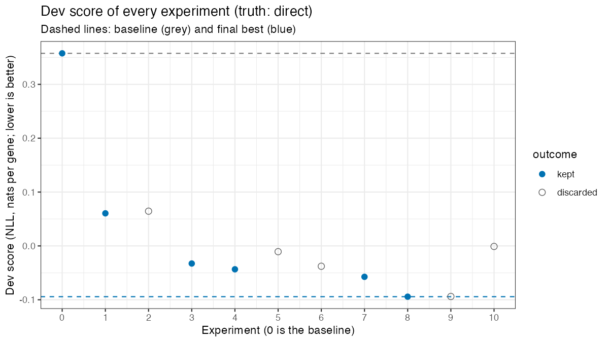
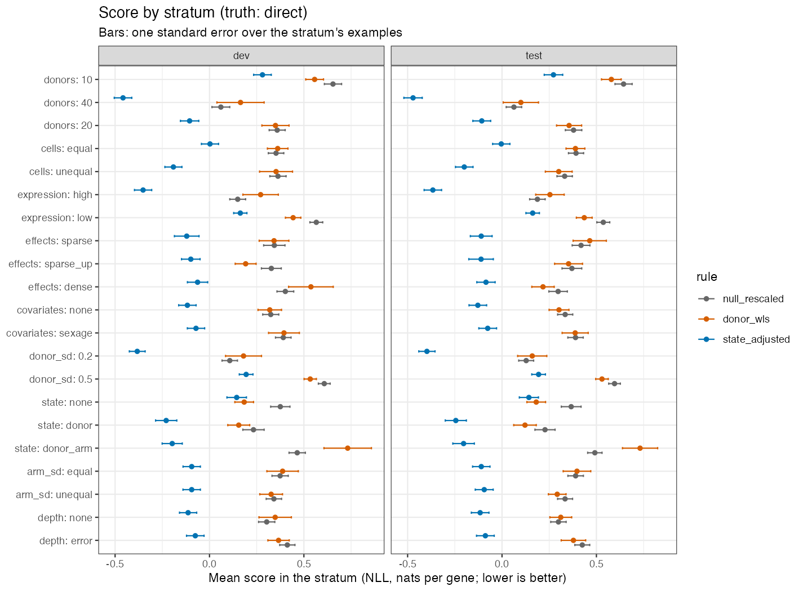
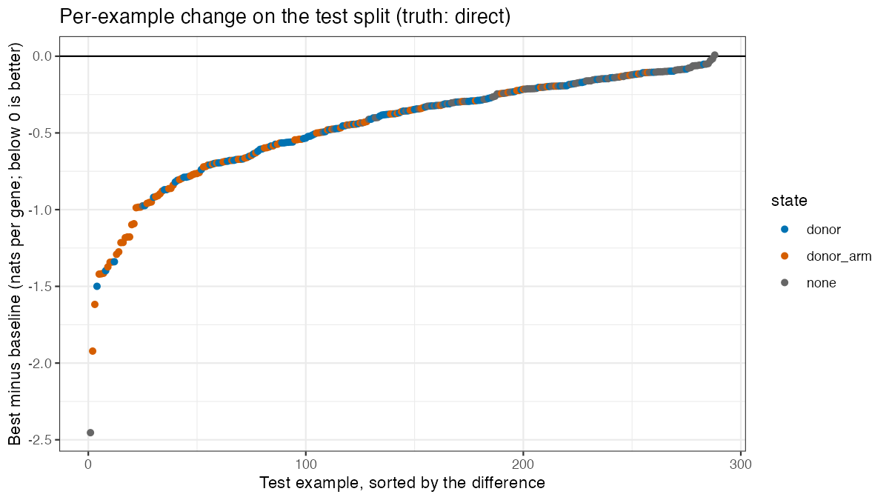
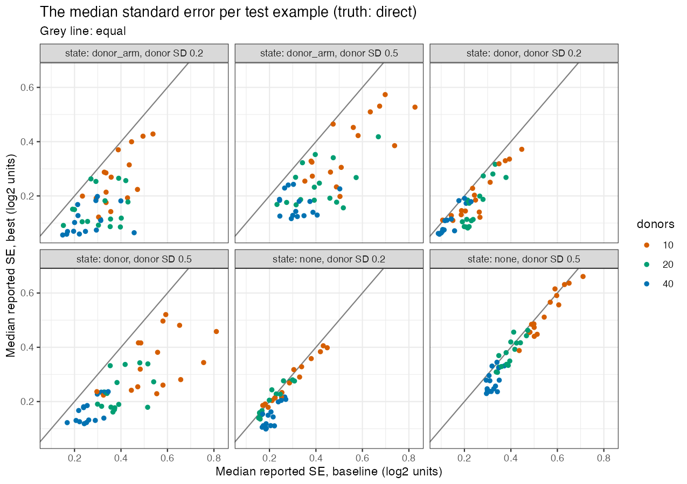
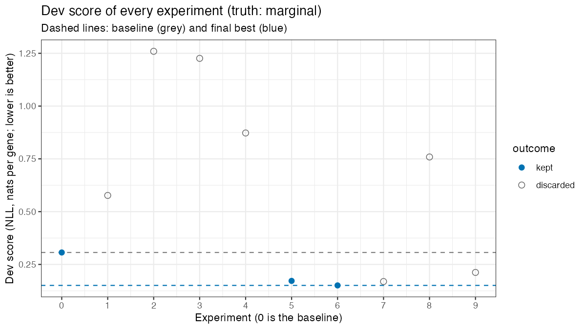
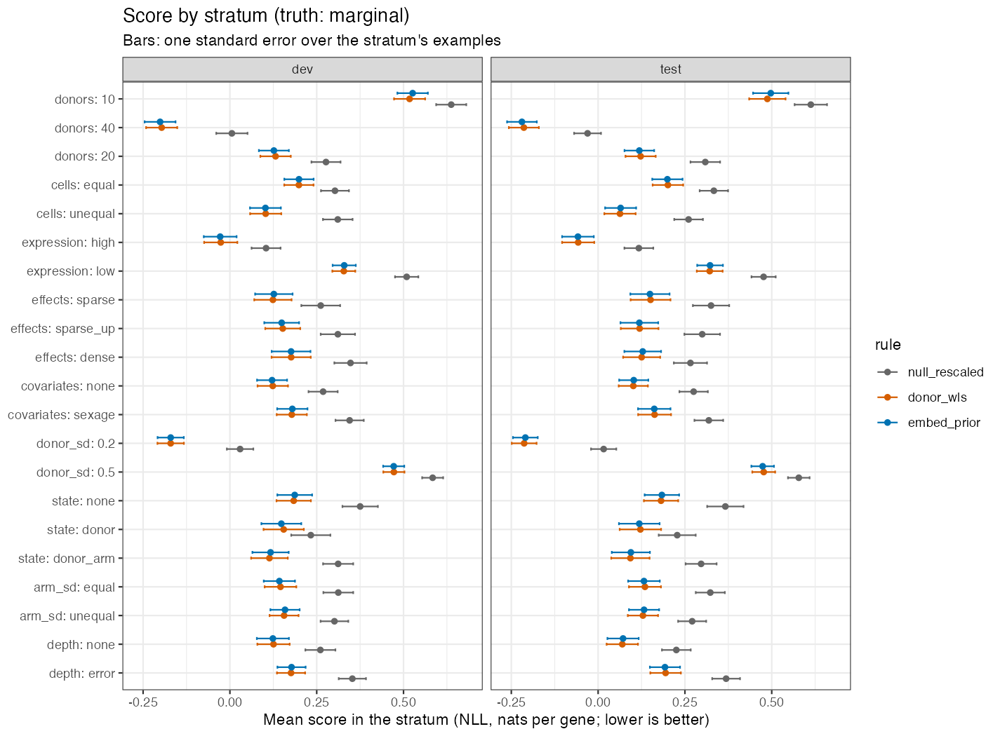
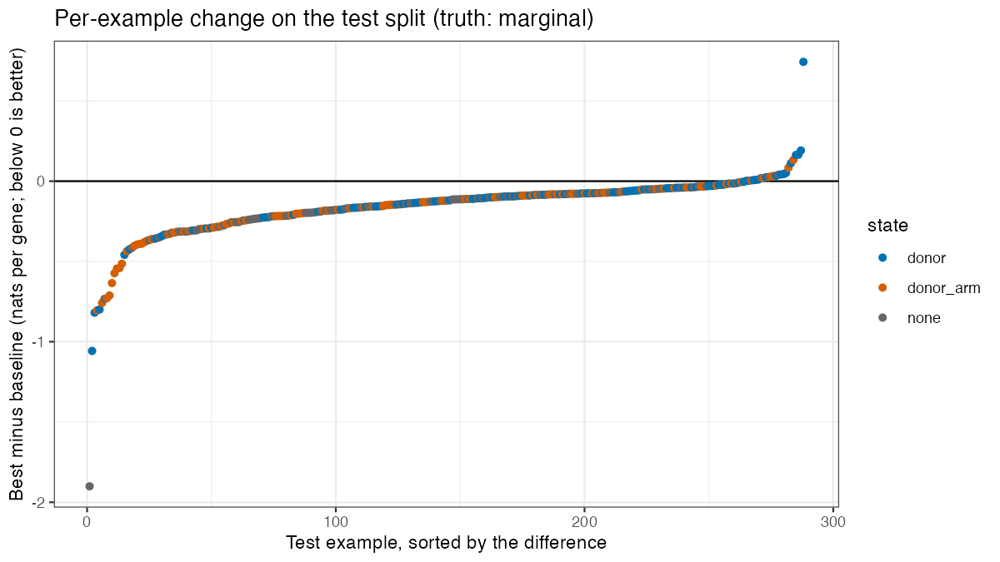
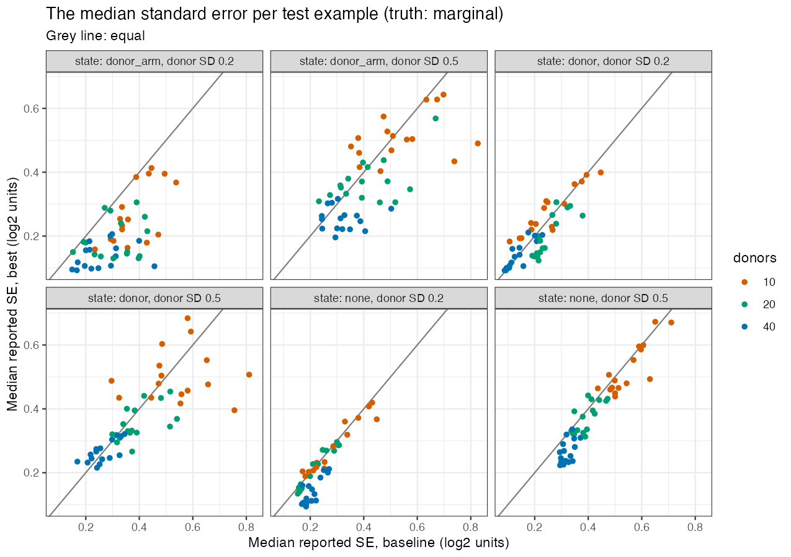

# Runs `nov11` and `nov11-direct`: rules that use the eSVD-DE embedding

Kevin Z. Lin (drafted by Claude), 2026-11-11. The design is
`MEMO_claude.md`, the bank is `BANK.md`. The knitted writeup
`RUN_nov11_claude.Rmd` / `.html` carries the same content with the
mathematics, the tables computed from `csv/RUN_nov11/`, and the figures
read; this file is the protocol's report and names every kept commit.

## 1. The runs

| | Run A | Run B |
|---|---|---|
| Truth the score uses | marginal effect (`ESVD2_TRUTH` unset) | direct effect, at fixed cell state (`ESVD2_TRUTH=direct`) |
| Branch | `autoresearch_lfcse2/nov11` | `autoresearch_lfcse2/nov11-direct` |
| Base commit | `c4c73fb` | `c4c73fb` |
| Budget agreed | 40 experiments or 4 hours, 8 cores | the same |
| Experiments | 9: 2 keep, 7 discard | 10: 5 keep, 5 discard |
| What stopped it | a decision: every rule that changed the logFC through the embedding lost, for a reason that is structural (section 2), and the kept rule equals `donor_wls` | a decision: the kept rule was at the bank's oracle row where donors have states, and the last two experiments were a tie and an ablation |
| Wall-clock per scoring | 17 to 22 seconds | 22 seconds |
| Best commit | `40e7e67` (`embed_prior`) | `1cfd07b` (`state_adjusted`) |

**Why there are two runs.** The memo fixed the truth as the marginal
effect $(\beta_g + s^\top y_g)/\ln 2$. The first experiments of run A
showed that under that truth the embedding cannot change the logFC, and
the scorer was given a switch to score against the direct effect
$\beta_g / \ln 2$ (memo, decision 10). The switch was added before any
experiment was logged, and the baseline was scored again. Run B is the
search under the direct effect. The choice between the two targets is
Kevin's.

No `gate_failed`, `crash` or `timeout` row was logged. One experiment of
run A (4, `b4731aa`) had a units error (an unweighted variance added to a
weighted one); it was a discard, and experiment 5 corrected it.

## 2. The best commits

**Run B, `1cfd07b`, `state_adjusted`**: "loadings regression extended by
the pairwise products of the loadings (the embedding's part of the
arithmetic-mean correction)". The rule estimates the effect at fixed cell
state. It runs `donor_wls`'s donor-level regression on the log donor
summaries with the embedding's donor offset taken out of the residuals,
regresses the arm coefficients on the fitted loadings and their pairwise
products across genes, subtracts the fitted loadings part, and rescales
the SE by the empirical null's SD within bounds.

**Run A, `40e7e67`, `embed_prior`**: "plain donor regression of the raw
summaries; the residual variance moderated toward a trend in the gene's
level and, additively, in the donor variance the embedding predicts for
the gene". Its logFC is `donor_wls`'s; the embedding enters the prior of
the variance moderation only, and scrambling the embedding moves its
output by 0.01 SE (section 5). By the memo's standard it does not use the
embedding in substance.

**Why the marginal effect leaves the embedding nothing to do.** The arms
of a cohort differ in mean donor state by $s + (\bar u_1 - \bar u_0)$, the
population shift plus donor sampling, which moves the arm contrast of
gene $g$ by $y_g^\top\{s + (\bar u_1 - \bar u_0)\}$. For the direct effect
all of it is error and can be removed along the loadings. For the marginal
effect the first part is signal and the second is error, one cohort
cannot separate them, and an unbiased rule keeps both. The fitted scores
are orthogonal to the arm by the reparameterization, so adjusting donors
for them changes the residual variance and not the contrast.

## 3. The procedure (`state_adjusted`)

**Input and output.** `report_lfc_se(view)` reads the counts $A_{cg}$,
the fitted library $\ell_{cg}$, the design, the donor and arm of each
cell, and the fitted embedding $\widehat x_c$, $\widehat y_g$ ($k$
factors). It returns $(\widehat\beta_g, s_g)$ in log2 units.

**Baseline (`null_rescaled`).** With $M_a$, $V_a$ the mean and mixture
variance over the donors of arm $a$ of the donor-averaged posterior,
$\widehat\beta^{\text{st}}_g = \log_2(M_1/M_0)$,
$s^{\text{st}}_g = \sqrt{V_1/(n_1 M_1^2) + V_0/(n_0 M_0^2)}/\ln 2$, and the
baseline reports
$(\widehat\beta^{\text{st}}_g - \delta_0 s^{\text{st}}_g,\; \sigma_0 s^{\text{st}}_g)$
with $(\delta_0, \sigma_0)$ the empirical null 1.2.0 fitted.

**The kept rule.**

1. $l_{dg} = \log\{(y_{dg} + 1/2)/L_{dg}\}$, with $y_{dg}$ the donor's
   summed counts and $L_{dg} = \sum_{c \in d}\ell_{cg}$.
2. $D$: the $n \times q$ donor-level design (intercept, arm, covariates
   constant within donors).
3. Embedding offset
   $$e_{dg} = \log\frac{\sum_{c \in d}\ell_{cg}\exp(\widehat x_c^\top \widehat y_g)}{L_{dg}},$$
   $e^r$ its residual on $D$, and
   $b = \sum_{d,g} e^r_{dg} l^r_{dg} / \sum_{d,g}(e^r_{dg})^2$ with $l^r$
   the residual of $l$ on $D$.
4. $l_{dg} - b\,e^r_{dg}$ is regressed on $D$ as in `donor_wls`: each
   donor's median residual over genes is removed, weights are
   $1/(\tau^2 + \phi/\mu_{dg})$ with $(\tau^2, \phi)$ fitted by least
   squares to the squared residuals and floored at 0, and weighted least
   squares gives $\widehat\theta_g$ (arm coefficient), $a_g$ (its variance
   factor) and $S_g$ on $\nu = n - q$ degrees of freedom, moderated toward
   its trend in the gene's level (Smyth 2004) to $\widetilde S_g$. Let
   $v_g = a_g \widetilde S_g$.
5. With
   $m_g = (1, \widehat y_g, \{\widehat y_{gj}\widehat y_{gj'}\}_{j \le j'})$,
   weighted least squares of $\widehat\theta_g$ on $m_g$ over the genes,
   weights $1/v_g$, two passes, the second without the genes whose first
   residual exceeds $3\sqrt{v_g}$. Coefficients: $c_0$, $\widehat d$,
   $\widehat Q$.
6. $$\widehat\beta^0_g = \frac{\widehat\theta_g - \widehat y_g^\top\widehat d - \widehat y_g^\top \widehat Q\,\widehat y_g}{\ln 2},
   \qquad s^0_g = \frac{\sqrt{v_g + h_g}}{\ln 2},$$
   $h_g$ the leverage of the gene's loading terms.
7. $(\delta_0, \sigma_0)$: the empirical null of $\widehat\beta^0_g/s^0_g$
   (`eSVD2::multtest()`);
   $f = \min\{\max(\sigma_0, 1), \sqrt{\nu/\max(\nu - k, 1)}\}$;
   $$\widehat\beta_g = \widehat\beta^0_g - \delta_0\,\text{median}_g s^0_g,
   \qquad s_g = f\,s^0_g.$$

The implementation is `notes/RULE_nov11_direct_claude.R`, which mirrors
`1cfd07b`; `notes/RULE_nov11_marginal_claude.R` mirrors `40e7e67`. Both
were sourced alone and run on 72 dev cohorts by
`diagnostics/scramble_check_claude.R`.

## 4. Dev and test against the baseline

Scores in nats per gene, lower is better; `donor_wls` and `deseq2` are the
references stored with the truth.

**Run B (truth: direct).**

```
                       null_rescaled        state_adjusted (1cfd07b)
                       dev       test       dev       test
score:                 0.3576    0.3620     -0.0943   -0.1020
rmse:                  0.3995    0.3987     0.3127    0.3127
coverage_95:           0.9262    0.9272     0.9460    0.9464
z_sd_null:             1.1321    1.1388     1.0146    1.0197
slope_weak:            0.9852    0.9837     0.9576    0.9627
se_strong:             1.0431    1.0416     1.0280    1.0274
score_vs_donor_wls:    0.0007    0.0172     -0.4512   -0.4467
score_state_none:      0.3751    0.3664     0.1440    0.1424
score_state_donor:     0.2330    0.2278     -0.2294   -0.2448
score_state_donor_arm: 0.4646    0.4918     -0.1975   -0.2036
score_marginal:        0.3066    0.2969     0.4110    0.3905
gate:                  pass      pass       pass      pass
```

The full blocks are in `csv/RUN_nov11/blocks.csv`. The last score line is
the same pairs scored against the marginal effect: `state_adjusted` is
worse than the baseline there, because it removes the arms' difference in
cell state on purpose.


| Split | `state_adjusted` minus | Difference | Paired SE | Gain in paired SE | Examples improved |
|---|---|---|---|---|---|
| dev | `null_rescaled` | -0.4519 | 0.0192 | 24 | 287 of 288 |
| dev | `donor_wls` | -0.4512 | 0.0521 | 9 | 268 of 288 |
| test | `null_rescaled` | -0.4640 | 0.0215 | 22 | 287 of 288 |
| test | `donor_wls` | -0.4467 | 0.0445 | 10 | 273 of 288 |

The dev gain carried to test, whose combinations of factor levels the run
never scored, so the run did not fit the dev bank.

**Run A (truth: marginal).**

| Rule | Dev | Test |
|---|---|---|
| `null_rescaled` | 0.3066 | 0.2969 |
| `donor_wls` | 0.1508 | 0.1319 |
| `embed_prior` (`40e7e67`) | 0.1506 | 0.1321 |

`embed_prior` gains 0.156 (dev) and 0.165 (test) on the baseline, 14
paired SE, and differs from `donor_wls` by -0.0002 (dev) and +0.0002
(test) with a paired SE of 0.0015.

## 5. Figures



Run B: the dev score fell at the first experiment by 0.30 nats and by a
further 0.15 over four later keeps.



Run B: `state_adjusted` is below the baseline and `donor_wls` in every
stratum of both splits, and equal to `donor_wls` within noise only at
`state = none`.



Run B: 287 of 288 test examples improve on the baseline, most where donors
have states.



Run B: the median SE is below the baseline's where donors have states,
most at donor SD 0.5.



Run A: four experiments that adjusted the summaries or the design for the
embedding scored 0.76 to 1.26, far above the baseline, and the two keeps
are the ones that left the logFC alone.



Run A: `embed_prior` and `donor_wls` coincide in every stratum.



Run A: 264 of 288 test examples improve on the baseline.



Run A: the median SE against the baseline's, by `state` and donor SD.

**The embedding check** (`csv/RUN_nov11/scramble.csv`, 72 dev cohorts).
With the scores permuted across cells and the loadings across genes, the
logFC of `state_adjusted` moves by 0.64 SE (`state = donor`) and 1.44 SE
(`donor_arm`) and its score against the direct effect goes from -0.13 to
0.19 and from -0.29 to 0.75. `embed_prior` moves by 0.015 SE and scores
the same.

## 6. What helped and why, by stratum

**Run B** (dev, against the direct effect; gain against the best at the
time).

| # | Commit | Direction | Idea | Gain (paired SE) | Strata that moved |
|---|---|---|---|---|---|
| 1 | `e3c223f` | E2 | Loadings component of the arm coefficients removed; residual variance free of the embedding offset | 0.297 (0.024) | RMSE 0.400 to 0.320; `donor` 0.233 to -0.048, `donor_arm` 0.465 to -0.013; coverage 0.877 |
| 3 | `17476b7` | E4 | SE rescaled by the empirical null's SD | 0.093 (0.016) | 10 donors 0.582 to 0.311; `none` 0.243 to 0.176; costs at 40 donors and `dense` |
| 4 | `76034e2` | E2 | Loadings regression weighted by precision, second pass without genes beyond 3 SE | 0.011 (0.001) | `sparse` -0.067 to -0.085 |
| 7 | `be490ef` | E4 | Rescaling held between 1 and $\sqrt{\nu/(\nu-k)}$ | 0.014 (0.005) | `dense` 0.027 to -0.034; 40 donors -0.367 to -0.410 |
| 8 | `1cfd07b` | E5 | Pairwise products of the loadings in the loadings regression | 0.037 (0.005) | `arm_sd` unequal -0.031 to -0.094; RMSE 0.321 to 0.313; `slope_weak` 0.981 to 0.958 |

The first commit is the embedding's use: two thirds of the run's gain.
The products of the loadings remove the whole cost of unequal donor
variance between the arms, a gain of information and not of scale. The
two rescaling commits are calibration.

**Run A** (dev, against the marginal effect).

| # | Commit | Direction | Idea | Gain (paired SE) | Strata that moved |
|---|---|---|---|---|---|
| 5 | `e2184ad` | E4 | Offset orthogonalized to the design, one coefficient per cohort; its weighted variance added back to the moderated residual variance | 0.135 (0.012) | every stratum; this is the move from the posterior to a donor-level regression |
| 6 | `40e7e67` | E4 | Raw donor regression; variance moderated toward a trend in level and in the embedding-predicted donor variance | 0.021 (0.003) | `none` 0.203 to 0.187 |

Both keeps are `donor_wls` reached from the baseline; neither is a gain
from the embedding.

## 7. What did not help

**Run A.**

| # | Commit | Direction | Idea | Change | Where it lost |
|---|---|---|---|---|---|
| 1 | `748d711` | E1 | `deshrunk`: posterior donor means, between-donor SE over the shrinkage weight | +0.270 | low expression 0.97 |
| 2 | `d9cdd34` | E1 | Donor regression on log posterior donor means | +0.953 | SE too small where the posterior shrinks: low expression 2.45, `none` 2.73 |
| 3 | `f19fe8c` | E2 | Full embedding offset before the regression | +0.919 | coverage 0.76; logFC unchanged |
| 4 | `b4731aa` | E4 | Offset variance added back (with a units error) | +0.566 | `donor` 1.23 |
| 7 | `dda8f30` | E5 | Arithmetic-mean correction from per-arm embedding variances | +0.018 | RMSE 0.426; better only at 40 donors |
| 8 | `4815c0c` | E3 | Donor-mean scores as design columns | +0.608 | coverage 0.80 |
| 9 | `e312037` | E5 | The fit's case-control coefficient as the logFC | +0.062 | unequal cells 0.214 against 0.102 |

**Run B.**

| # | Commit | Direction | Idea | Change | Where it lost |
|---|---|---|---|---|---|
| 2 | `b69cffd` | E4 | Residual variance charged $k$ degrees of freedom | +0.004 | overcorrects; 10 donors 0.655 |
| 5 | `b3dd4ce` | E3 | Per-gene regression on the donor-mean scores, exact degrees of freedom, no rescaling | +0.033 | coverage 0.902; better at 40 donors |
| 6 | `cdaecf7` | E3 | The same with the null-SD rescaling | +0.006 | no stratum better |
| 9 | `34eaebe` | E2 | Third pass of the loadings regression | +0.0004 | none |
| 10 | `8082f9a` | E4 | Ablation: no rescaling | +0.093 | coverage 0.890; 10 donors 0.519 |

Posterior-based summaries (E1) lose because the posterior shrinks donors
toward the fit, as the exploration found. Putting the scores in the
regression (E2 as an offset, E3 as covariates) loses under the marginal
truth because the scores are orthogonal to the arm.

## 8. Truth changes

The truth was not on trial within a run. Between the runs the score's
truth was switched by an environment variable (section 1), and every block
prints the score against both.

## 9. Numeric constants the kept commits introduced

| Constant | Where | Reason | Dev-fitted |
|---|---|---|---|
| 3 | exclusion threshold of the loadings regression, in SE | a normal residual is beyond 3 SE once in 370 genes | no |
| 2 | passes of the loadings regression | one to find those genes, one without them; a third changed the score by 0.0004 | no |
| 1 | lower bound of the SE factor | removing the offset cannot make the residual variance too large | no |
| $\sqrt{\nu/(\nu - k)}$ | upper bound of the SE factor | the offset has $k$ free directions among $\nu$ | no |

The constants inherited from `donor_wls` (the half count, the floors at 0,
the trigamma inverse's 50 and $10^{-8}$) are unchanged.

## 10. Suggested next experiments

1. **The rank (a bank factor).** Rank 5 against 3 or 4 true directions;
   real fits use ranks near or above the donor count, where the scores can
   absorb all donor-level variation and the SE bound no longer binds.
2. **Effects aligned with the loadings (a bank factor).** The direct
   effects are independent of the loadings here. If a disease acts through
   a program the embedding has learned, the loadings regression removes
   part of the effect; `slope_weak` is already 0.958.
3. **The SE factor at 40 donors (E4).** Without rescaling the score at 40
   donors is better (-0.449); a calibration that does not read the genes'
   own statistics would keep that.

Out-of-bounds direction the numbers argue for: under the marginal truth, a
rule that removed the loadings part in proportion to how much of it donor
sampling explains would lower the error at `state = donor`, but it shrinks
a component of the logFC toward zero, which the memo excludes.

## 11. Reproducibility

| | |
|---|---|
| Bank | `lfcse-bank-2` (`BANK_INFO.md` in the bank's folder) |
| Manifest rows | 288 dev, 288 test |
| Scorer budget | 600 seconds; 8 cores |
| Harness commit | `c4c73fb` (unchanged during both runs) |
| Rescore run B's best | `git checkout 1cfd07b && ESVD2_TRUTH=direct Rscript autoresearch_lfcse2/harness/evaluate_claude.R dev` |
| Rescore run A's best | `git checkout 40e7e67 && Rscript autoresearch_lfcse2/harness/evaluate_claude.R dev` |
| Tables and figures | `Rscript autoresearch_lfcse2/diagnostics/report_run_nov11_claude.R` (reads `output/run_marginal/` and `output/run_direct/`, not tracked) |
| Embedding check | `Rscript autoresearch_lfcse2/diagnostics/scramble_check_claude.R` |

The test split was scored once per run, at the run's best commit
(`output/run_*/test_runs.tsv`).
